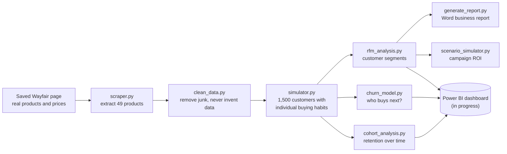
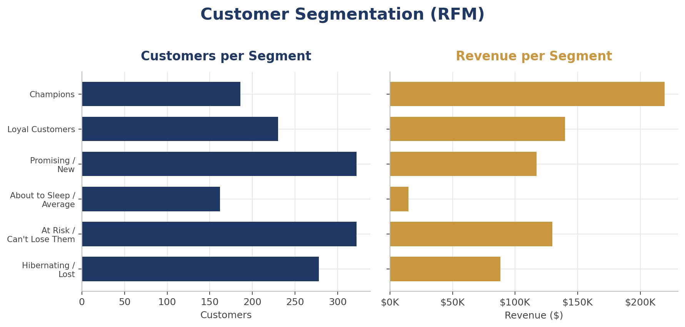
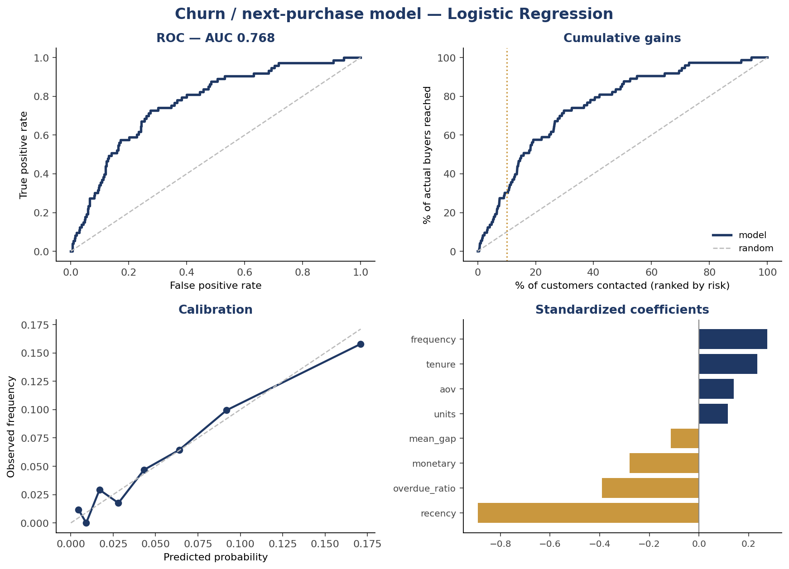
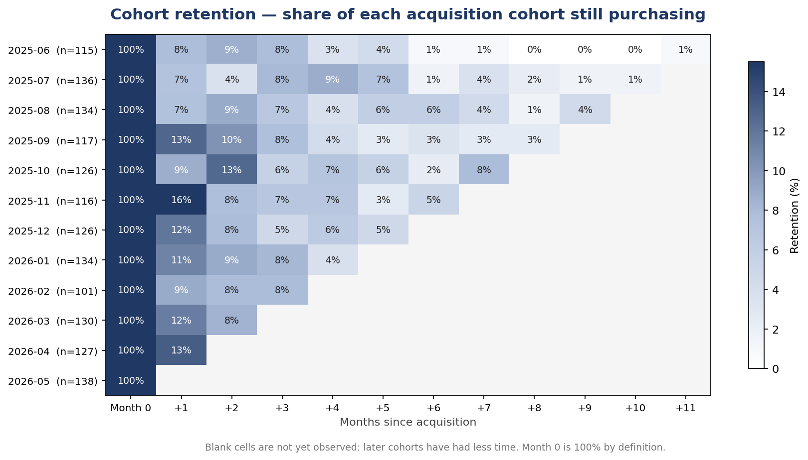
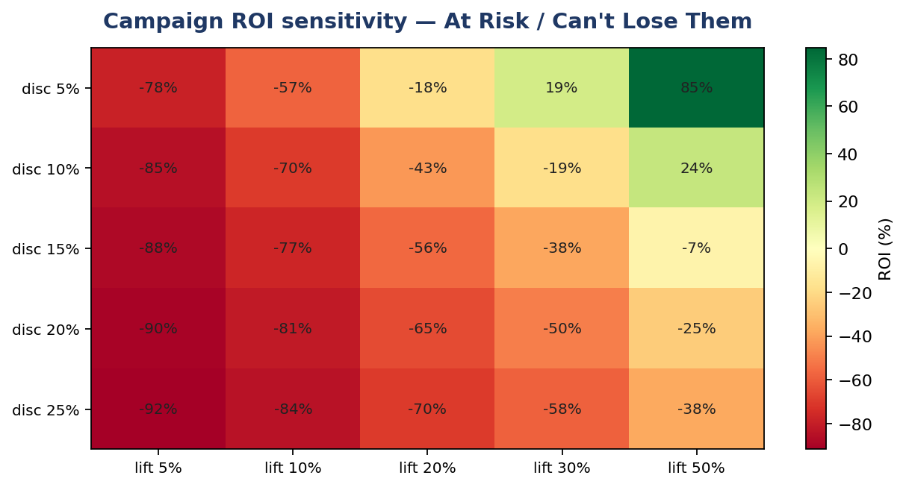

# E-Commerce Customer Analytics Pipeline

**Real Wayfair catalog data · Simulated customers · Segmentation, churn prediction, cohort retention, and campaign ROI modeling**

What happens after someone buys from an online store? Do they come back? Which customers are worth the most, which ones are slipping away, and would a discount win them back or just hand money to people who were going to buy anyway?

This project answers those questions end to end for a simulated online rug store built on **real Wayfair products and prices**. It starts from a saved Wayfair web page, generates a year of realistic customer behavior on top of it, and turns that into four decision tools plus an automatically generated business report.

**Scale:** 49 real products · 1,500 simulated customers · 2,169 orders · $709K in simulated revenue

---

## At a glance

| The business question | What this project built | The answer it found |
|---|---|---|
| Who are our best customers? | Customer segmentation (RFM) | **Champions are 12% of customers but 31% of revenue** |
| Who is about to stop buying? | Churn prediction model | Finds likely buyers **2.7× better than a random list** |
| How fast do new customers drop off? | Cohort retention analysis | **11%** buy again the next month; **3%** by month six |
| Would this discount pay off? | What-if campaign calculator | 15% off for "At Risk" customers **loses money (−77% ROI)** |

---

## How it works



---

## Real data vs. simulated data

This is the most important thing to understand about the project.

- **Real:** 49 Wayfair area rugs, with their actual names and prices, extracted from a saved Wayfair product listing page.
- **Simulated:** every customer, order, and date. Wayfair's sales data is private, so the project generates customers with realistic buying habits and a year of orders against the real catalog. Customer names are computer-generated and don't refer to real people.

The two are never mixed silently. Findings about products and prices reflect real catalog data; findings about customer behavior reflect the simulation.

<details>
<summary><b>Technical details</b></summary>

- Every catalog row carries a `Source` column (`scraped` or `synthetic_fallback`). `simulator.py` checks it and refuses to generate transactions against non-scraped rows without explicit confirmation.
- Fallback or sample data is always written to a distinct filename (`product_catalog_SAMPLE.csv`), never over real output. `clean_data.py` exits with an error rather than inventing replacement products.
- The scraper selects titles and prices by exact CSS class sets verified against the page (49/49 clean extraction), with a text-heuristic fallback. Product IDs are a stable hash of name and price.

</details>

### How the simulated customers behave

Real customers aren't interchangeable. Some buy often, most buy rarely, and eventually most stop buying altogether. The simulator gives each customer their own buying habits and their own "lifespan" as a customer, and they join the store at different points in the year. That realism is what makes the prediction and retention analysis possible (see [what went wrong](#five-times-the-obvious-answer-was-wrong) for how that was discovered).

<details>
<summary><b>Technical details</b></summary>

- Customers follow a **Pareto/NBD** process (Schmittlein, Morrison & Colombo, 1987), the standard model for non-contractual customer bases. Each customer draws a Gamma-distributed purchase rate λ and a Gamma-distributed lifetime, then purchases via a Poisson process from acquisition until dropout or window end.
- Acquisition dates are staggered across the 365-day window, producing genuine monthly cohorts.
- Transaction volume is an *output* of the process, not a fixed input.
- The latent parameters are written to `customer_truth.csv`, giving ground truth for validating the churn model against the process that generated the data.
- Fully reproducible under a fixed seed: a clean run regenerates every dataset identically.

</details>

---

## What the project delivers

### 1. Customer segmentation (RFM)

Every customer is scored on three things: how **R**ecently they bought, how **F**requently, and how much **M**oney they've spent. They're then sorted into groups a marketing team can act on.

**Champions make up 12% of customers but bring in 31% of revenue.**



| Segment | Share of customers | Share of revenue |
|---|---|---|
| Champions | 12.4% | 30.9% |
| Loyal Customers | 15.3% | 19.7% |
| At Risk / Can't Lose Them | 21.5% | 18.3% |
| Promising / New | 21.5% | 16.5% |
| Hibernating / Lost | 18.5% | 12.4% |
| About to Sleep / Average | 10.8% | 2.1% |

<details>
<summary><b>Technical details</b></summary>

- Each dimension is scored on a 1–5 quintile scale; six rule-based segments are assigned from the combined scores.
- Scores use `.rank(method='first')` before `pd.qcut`, so tied values (common with integer purchase counts) can't produce duplicate bin edges. Passing `duplicates='drop'` to `qcut` instead fails when explicit labels are supplied.
- The analysis snapshot date is derived from the data (`max(InvoiceDate) + 1 day`), not hardcoded.

</details>

### 2. Churn prediction

A model estimates each customer's chance of buying again in the next 30 days. If a team can only afford to contact 10% of its customers, the model's list reaches **2.7× more of the people about to buy** than a random list would.

Because the simulation's hidden settings are known, the model can also be checked against the truth, not just against its own test data. **97% of the customers it ranked least likely to return really had quit**, compared with 36% of those it ranked most likely.



<details>
<summary><b>Technical details</b></summary>

- **Features:** recency, frequency, monetary value, average order value, tenure, units, mean inter-purchase gap, and an "overdue" ratio (recency relative to the customer's own typical gap).
- **Leakage-free temporal design:** features use only transactions on or before a cutoff; labels come from the following 30 days.
- **Model selection:** logistic regression, random forest, and gradient boosting compared under 5-fold stratified CV. Logistic regression won.
- **Evaluation:** because only ~5% of customers buy in a given window, ROC AUC is reported alongside average precision (vs. the base rate) and top-decile capture:

  | | ROC AUC | Avg precision | Top-decile capture |
  |---|---|---|---|
  | Cross-validated | 0.768 | 0.146 | 30% |
  | **Forward backtest** (train earlier, test later) | **0.695** | **0.112** | **27%** |
  | Random baseline | 0.500 | 0.053 | 10% |

  The forward backtest is the honest estimate of deployed performance, since training data strictly precedes test data.
- **Calibrated probabilities** (Brier 0.049), so scores can be used as expected values in campaign planning, not just as a ranking.
- **Ground-truth validation:** predicted probability correlates with the true purchase rate at ρ = +0.296 and identifies genuinely active customers at AUC 0.772.
- Outputs `churn_predictions.csv` with a probability, churn risk, and risk decile per customer (decile 10 = highest risk).

</details>

### 3. Cohort retention

Customers are grouped by the month they first bought, then tracked month by month. **About 11% of new customers buy again the following month; by month six it's about 3%.**

The analysis also checks whether newer customers are better or worse than older ones. They aren't: an apparent improvement turned out to be random noise.



<details>
<summary><b>Technical details</b></summary>

- **Right-censoring made explicit:** later cohorts have had less time to be observed, so every column average is reported with the number of cohorts behind it.
- **Cohort quality compared at a fixed offset** (month +1), tested with linear regression: slope +0.44 pp per cohort, **p = 0.086**, not significant.
- **Observed zeros are distinguished from unobserved cells.** A cohort that went quiet in an observed month shows `0%`; only months that haven't happened yet are blank.
- Cohorts under 30 customers are flagged and excluded from summary statistics.
- Also reports cumulative revenue per cohort member (the payback view), and exports `cohort_retention_long.csv` in tidy long format for Power BI.

</details>

### 4. What-if campaign calculator

Type in a campaign idea, such as *"15% off for At Risk customers, expecting 10% more of them to buy,"* and the calculator reports whether it makes or loses money, and how big the response would need to be just to break even.

That example **loses money, at −77% ROI.** The discount goes to everyone who uses it, including customers who would have bought anyway, and here **about 10× more discount goes to those customers** than to the customers the offer actually won over. It would need a 55% response lift to break even. Smaller discounts need far less: 5% off breaks even at a 25% lift.



<details>
<summary><b>Technical details</b></summary>

- Profit model accounts for **discount cannibalization** (discount paid on baseline purchases), redemption rate, per-contact cost, and gross margin.
- **Break-even lift is solved in closed form** rather than guessed, since that's the number a go/no-go decision turns on.
- **Baselines are measured out of sample.** Segments are rebuilt on history and conversion is measured in a held-out 30-day window, avoiding a circular 0% baseline for "At Risk" customers (see below).
- A runtime check warns when segment baselines look untrustworthy (narrow spread, or Champions converting no better than Hibernating).
- Command-line tool with a `--sweep` sensitivity grid and heatmap output. Margin and cost inputs are planning assumptions and can be overridden.

</details>

### 5. Automated business report

A formal Word report covering KPIs, monthly revenue trends, top and bottom products, revenue concentration, and customer segments. It's generated from the data by a script, so it can be rebuilt any time the data changes.

<details>
<summary><b>Technical details</b></summary>

- Built with `python-docx` and `matplotlib`; figures in the narrative are computed at generation time rather than typed in.
- Degrades gracefully: if segment data is missing, the segmentation section is omitted rather than the build failing.

</details>

---

## Five times the obvious answer was wrong

Results are only worth something if they're right. These are the points where a standard approach produced a confident but wrong answer, and how each one was caught.

**1. The model that was no better than a coin flip.**
The first churn model predicted no better than guessing. Rather than tune it, the data was investigated. The original simulation gave every customer identical random behavior, so past purchases said nothing about future ones. The simulator was rebuilt so customers have individual habits and eventually stop buying, and the same model went from coin-flip accuracy (AUC 0.48) to 0.76.

<details>
<summary><b>Technical details</b></summary>

The original simulator assigned each transaction via `random.choice(customers)`, making future purchases statistically independent of past ones. Every downstream symptom traced back to that one line:

| Symptom | Uniform random | Pareto/NBD model |
|---|---|---|
| Churn model AUC | 0.480 | 0.763 |
| Purchase frequency's correlation with repurchase | −0.0003 | +0.163 |
| Month-1 cohort retention | 35% (flat) | 10.6% (decaying) |
| Cohort sizes over 12 months | 157 → 2 | 101–138 |
| Repeat-purchase rate | 96.2% | 28.0% |

</details>

**2. The standard fix that made predictions about 7× too high.**
Only about 5% of customers buy in any 30-day window. The usual fix for rare outcomes inflated the model's probabilities roughly sevenfold, which would have made every campaign estimate wrong. Removing it made the model both more accurate and properly calibrated.

<details>
<summary><b>Technical details</b></summary>

With `class_weight="balanced"`, mean predicted probability was 0.389 against an actual rate of 0.053, and the Brier score was 0.198. Without it: Brier 0.049, and ROC AUC slightly *improved* (0.761 → 0.768). Rebalancing rescales probabilities to a 50/50 world, which is harmful when the probabilities are used as expected values.

</details>

**3. "Big spenders are more likely to leave." (They aren't.)**
The model appeared to say that customers who spend more are more likely to stop buying. That's a statistical illusion caused by inputs that overlap with each other. The model's output now flags these cases so the numbers can't be misread.

<details>
<summary><b>Technical details</b></summary>

`monetary` correlates +0.024 with repurchase on its own but receives a −0.279 coefficient. The features are heavily collinear (monetary ↔ AOV 0.85; recency ↔ overdue ratio 0.91), so coefficients are partial effects. The script prints each coefficient beside the feature's own correlation and flags sign disagreements. Ranking quality is unaffected.

</details>

**4. A campaign that looked infinitely profitable.**
Measured the obvious way, "At Risk" customers had a 0% chance of buying on their own, which makes any campaign aimed at them look like pure profit. But that's circular: they're labeled "At Risk" *because* they haven't bought recently. Measured properly on a later time period, their real rate is 2%.

<details>
<summary><b>Technical details</b></summary>

Measuring conversion in the same window that defines recency re-reads the segment definition. Naive same-window rates were 0.0% for At Risk and 40.9% for Champions; out-of-sample rates (segments rebuilt on history, outcomes from a held-out 30 days) are 2.0% and 16.9%.

</details>

**5. A trend that wasn't there.**
The cohort analysis first reported that newer customers were getting better. A proper statistical test showed the pattern was random noise, which matches how the data was actually generated.

<details>
<summary><b>Technical details</b></summary>

An initial heuristic compared the slope to the spread and flagged a trend. It was replaced with an ordinary least-squares significance test (`scipy.stats.linregress`): +0.44 pp per cohort, SE 0.23, p = 0.086, n = 11.

</details>

---

## Tech stack

| Area | Tools |
|---|---|
| Data collection | Python, BeautifulSoup |
| Data processing | pandas, NumPy |
| Simulation | NumPy (Gamma and Poisson processes), Faker |
| Machine learning | scikit-learn |
| Statistics | SciPy |
| Visualization | matplotlib |
| Reporting | python-docx |
| Business intelligence | Power BI (dashboard in progress) |

**Methods:** Pareto/NBD customer simulation · RFM segmentation · leakage-free temporal backtesting · probability calibration · cohort analysis with right-censoring · statistical significance testing · scenario and sensitivity modeling

---

## Run it yourself

```bash
pip install -r requirements.txt

python scripts/scraper.py            # extract products from the saved page
python scripts/clean_data.py         # clean the catalog
python scripts/simulator.py          # generate customers and orders
python scripts/rfm_analysis.py       # segment customers
python scripts/generate_report.py    # build the Word report

python scripts/churn_model.py        # train and evaluate the churn model
python scripts/cohort_analysis.py    # cohort retention analysis
python scripts/scenario_simulator.py --segment "At Risk / Can't Lose Them" --discount 15 --lift 10
```

Every script runs from the project root or from inside `scripts/`. A fixed random seed makes every run reproduce the same results.

<details>
<summary><b>Repository layout</b></summary>

```
├── data/          raw page, cleaned catalog, simulated orders, and every analysis output
├── scripts/       the eight pipeline and analysis scripts
├── reports/       the generated Word report
├── docs/          technical notes and README images
└── requirements.txt
```

</details>

---

## Limitations

- **Customer behavior is simulated.** Segment sizes, retention rates, and churn patterns reflect the simulation's assumptions, not real Wayfair shoppers. The value is in the methods, which would apply unchanged to real transaction data.
- **Products are chosen at random** within the simulation, so revenue is probably more concentrated in expensive rugs than it would be in reality.
- **Gross margin (45%) and campaign costs are planning assumptions,** not measured figures.
- **The catalog is a single snapshot** of one Wayfair page, and the scraper depends on page structure that changes whenever Wayfair updates its site.

## What's next

- Power BI dashboard (in progress)
- Target campaigns by predicted churn risk instead of by segment
- Price-weighted product selection in the simulator

---

Design decisions, known fragilities, and verification details are documented in [docs/TECHNICAL_NOTES.md](docs/TECHNICAL_NOTES.md).

*Not affiliated with or endorsed by Wayfair. Product names and prices come from a publicly viewable listing page; all customer and transaction data is synthetic.*
