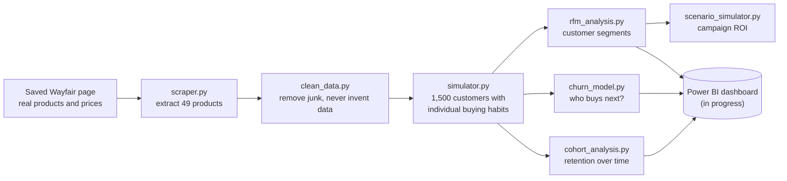

# E-Commerce Customer Analytics Pipeline

**Real Wayfair catalog data · Simulated customers · Segmentation, churn prediction, cohort retention, and campaign ROI modeling**

What happens after someone buys from an online store? Do they come back? Which customers are worth the most, which ones are slipping away, and would a discount win them back or just hand money to people who were going to buy anyway?

This project answers those questions end to end for a simulated online rug store built on **real Wayfair products and prices**. It starts from a saved Wayfair web page, generates a year of realistic customer behavior on top of it, and turns that into four decision tools.

**Scale:** 49 real products · 1,500 simulated customers · 2,077 orders · $701K in simulated revenue

---

## At a glance

| The business question | What this project built | The answer it found |
|---|---|---|
| Who are our best customers? | Customer segmentation (RFM) | **Champions are 5% of customers but 17% of revenue** |
| Who is about to stop buying? | Churn prediction model | Finds likely buyers **3.1× better than a random list** |
| How fast do new customers drop off? | Cohort retention analysis | **9%** buy again the next month; **3%** by month six |
| Would this discount pay off? | What-if campaign calculator | 15% off for recent one-time buyers **loses money (−70% ROI)** |

---

## How it works



---

## Real data vs. simulated data

This is the most important thing to understand about the project.

- **Real:** 49 Wayfair area rugs, with their actual names and prices, extracted from a saved Wayfair product listing page.
- **Simulated:** every customer, order, and date. Wayfair's sales data is private, so the project generates customers with realistic buying habits and a year of orders against the real catalog. Customer names are computer-generated and don't refer to real people.

The two are never mixed silently. Findings about products and prices reflect real catalog data; findings about customer behavior reflect the simulation.

<details>
<summary><b>Technical details</b></summary>

- Every catalog row carries a `Source` column (`scraped` or `synthetic_fallback`). `simulator.py` checks it and refuses to generate transactions against non-scraped rows without explicit confirmation.
- Fallback or sample data is always written to a distinct filename (`product_catalog_SAMPLE.csv`), never over real output. `clean_data.py` exits with an error rather than inventing replacement products.
- The scraper selects titles and prices by exact CSS class sets verified against the page (49/49 clean extraction), with a text-heuristic fallback. Product IDs are a stable hash of name and price.

</details>

### How the simulated customers behave

Real customers aren't interchangeable. Some buy often, most buy rarely, and eventually most stop buying altogether. The simulator gives each customer their own buying habits and their own "lifespan" as a customer, and they join the store at different points in the year. That realism is what makes the prediction and retention analysis possible (see [what went wrong](#five-times-the-obvious-answer-was-wrong) for how that was discovered).

<details>
<summary><b>Technical details</b></summary>

- Customers follow a **Pareto/NBD** process (Schmittlein, Morrison & Colombo, 1987), the standard model for non-contractual customer bases. Each customer draws a Gamma-distributed purchase rate λ and a Gamma-distributed dropout hazard μ, then an exponential lifetime at that hazard — which makes the lifetime Lomax (Pareto type II) distributed, the "Pareto" the model is named for. Purchases follow a Poisson process from acquisition until dropout or the end of the window.
- Acquisition dates are staggered across the 365-day window, producing genuine monthly cohorts.
- Transaction volume is an *output* of the process, not a fixed input.
- The latent parameters are written to `customer_truth.csv`, giving ground truth for validating the churn model against the process that generated the data.
- Fully reproducible under a fixed seed: a clean run regenerates every dataset identically.

</details>

---

## What the project delivers

### 1. Customer segmentation (RFM)

Every customer is scored on three things: how **R**ecently they bought, how **F**requently, and how much **M**oney they've spent. They're then sorted into groups a marketing team can act on.

**Champions make up 5% of customers but bring in 17% of revenue**, while 77% of customers place a single order and never return.

| Segment | Share of customers | Share of revenue |
|---|---|---|
| Hibernating / Lost | 38.6% | 31.9% |
| Promising / New | 34.7% | 28.5% |
| Champions | 5.1% | 16.8% |
| About to Sleep / Average | 18.0% | 13.2% |
| Loyal Customers | 2.1% | 5.7% |
| At Risk / Can't Lose Them | 1.5% | 3.8% |

<details>
<summary><b>Technical details</b></summary>

- **Tied customers always receive the same score.** Recency and monetary use tie-aware quintiles (percentile rank with `method="average"`), so buckets come out uneven whenever values repeat — the correct trade, since two customers who behaved identically must not score differently.
- **Frequency uses explicit order-count bands** (1 / 2 / 3 / 4–5 / 6+) rather than quintiles. Quintiles cannot split a value shared by 77% of the population.
- **Why this matters:** an earlier version called `.rank(method="first")` before `pd.qcut` to force five equal buckets. It stopped `qcut` erroring on ties, but broke them by row order, spreading identical one-order customers across F-scores 1–4 — which put 18 one-time buyers in Champions and 109 in Loyal Customers.
- **Segment rules test frequency first.** With repeat buying this scarce, the classic recency-first grid collapses 91% of customers into two labels and leaves one segment empty.
- Scoring lives in `rfm_analysis.py` and is imported by `scenario_simulator.py`, which used to keep its own copy — the kind of duplicate that silently retains a bug after the original is fixed.

</details>

### 2. Churn prediction

A model estimates each customer's chance of buying again in the next 30 days. If a team can only afford to contact 10% of its customers, the model's list reaches **3.1× more of the people about to buy** than a random list would.

Because the simulation's hidden settings are known, the model can also be checked against the truth, not just against its own test data. **86% of the customers it ranked least likely to return really had quit**, compared with 42% of those it ranked most likely.

<details>
<summary><b>Technical details</b></summary>

- **Features:** recency, frequency, monetary value, average order value, tenure, units, mean inter-purchase gap, and an "overdue" ratio (recency relative to the customer's own typical gap).
- **Leakage-free temporal design:** features use only transactions on or before a cutoff; labels come from the following 30 days.
- **Model selection happens on an earlier snapshot.** Logistic regression, random forest, and gradient boosting are compared under 5-fold stratified CV on data that ends a month before the test period, then the winner is locked in. Selecting on the test period would let it influence the choice — the same leak as tuning on a test set. Random forest wins here; on the later snapshot logistic regression would have, so the safeguard is not theoretical.
- **Evaluation:** because only ~4% of customers buy in a given window, ROC AUC is reported alongside average precision (vs. the base rate) and top-decile capture:

  | | ROC AUC | Avg precision | Top-decile capture |
  |---|---|---|---|
  | Selection snapshot (CV) | 0.775 | 0.118 | 31% |
  | **Forward backtest** (train earlier, test later) | **0.696** | **0.096** | **31%** |
  | Random baseline | 0.500 | 0.039 | 10% |

  The forward backtest is the honest estimate of deployed performance, since training data strictly precedes test data and the algorithm was chosen without seeing it.
- **Ranking, not calibrated probabilities.** The forward Brier score is 0.0373 against 0.0378 for simply predicting the base rate for everyone — a skill score of +1.2%, which is parity. The scores rank customers usefully; they are not established as probabilities and should not be fed into an ROI model as expected values without recalibration. The script prints this check rather than assuming it.
- **Ground-truth validation:** predicted probability correlates with the true purchase rate at ρ = +0.174 and identifies genuinely active customers at AUC 0.692. These use out-of-time scores, so they are not inflated by the model having seen the same outcomes.
- Outputs `churn_predictions.csv` with a probability, churn risk, and risk decile per customer (decile 10 = highest risk).

</details>

### 3. Cohort retention

Customers are grouped by the month they first bought, then tracked month by month. **About 9% of new customers buy again the following month; by month six it's about 3%.**

The analysis also checks whether newer customers are better or worse than older ones. They aren't: an apparent improvement turned out to be random noise.

<details>
<summary><b>Technical details</b></summary>

- **Right-censoring made explicit:** later cohorts have had less time to be observed, so every column average is reported with the number of cohorts behind it.
- **Cohort quality compared at a fixed offset** (month +1), tested with linear regression: slope −0.37 pp per cohort, **p = 0.075**, not significant.
- **Observed zeros are distinguished from unobserved cells.** A cohort that went quiet in an observed month shows `0%`; only months that haven't happened yet are blank.
- Cohorts under 30 customers are flagged and excluded from summary statistics.
- Also reports cumulative revenue per cohort member (the payback view), and exports `cohort_retention_long.csv` in tidy long format for Power BI.

</details>

### 4. What-if campaign calculator

Type in a campaign idea, such as *"15% off for recent one-time buyers, expecting 10% more of them to buy,"* and the calculator reports whether it makes or loses money, and how big the response would need to be just to break even.

That example **loses money, at −70% ROI.** The discount goes to everyone who uses it, including customers who would have bought anyway, and here **about 10× more discount goes to those customers** ($1,093) than to the customers the offer actually won over ($109). It would need a 42% response lift to break even. Smaller discounts need far less: 5% off breaks even at a 15% lift.

<details>
<summary><b>Technical details</b></summary>

- Profit model accounts for **discount cannibalization** (discount paid on baseline purchases), redemption rate, per-contact cost, and gross margin.
- **Break-even lift is solved in closed form** rather than guessed, since that's the number a go/no-go decision turns on.
- **Baselines are measured out of sample.** Segments are rebuilt on history and conversion is measured in a held-out 30-day window, avoiding the circular baselines described below.
- **Segments too small to measure are named, not guessed at.** A segment with no observed conversions cannot anchor a ratio, and treating it as a 0% baseline would make any campaign aimed at it look infinitely profitable. The tool reports it as unmeasured and asks for an explicit `--baseline` instead.
- A runtime check also warns when the measurable baselines look untrustworthy (narrow spread, or Champions converting no better than Hibernating).
- Command-line tool with a `--sweep` sensitivity grid and heatmap output. Margin and cost inputs are planning assumptions and can be overridden.

</details>

---

## Five times the obvious answer was wrong

Results are only worth something if they're right. These are the points where a standard approach produced a confident but wrong answer, and how each one was caught.

**1. The model that was no better than a coin flip.**
The first churn model predicted no better than guessing. Rather than tune it, the data was investigated. The original simulation gave every customer identical random behavior, so past purchases said nothing about future ones. The simulator was rebuilt so customers have individual habits and eventually stop buying, and the same model went from coin-flip accuracy (AUC 0.48) to 0.74.

<details>
<summary><b>Technical details</b></summary>

The original simulator assigned each transaction via `random.choice(customers)`, making future purchases statistically independent of past ones. Every downstream symptom traced back to that one line:

| Symptom | Uniform random | Pareto/NBD model |
|---|---|---|
| Churn model AUC | 0.480 | 0.739 |
| Purchase frequency's correlation with repurchase | −0.0003 | +0.126 |
| Month-1 cohort retention | 35% (flat) | 9.0% (decaying) |
| Cohort sizes over 12 months | 157 → 2 | 109–155 |
| Repeat-purchase rate | 96.2% | 23.0% |

</details>

**2. The standard fix that made predictions about 7× too high.**
Only about 4% of customers buy in any 30-day window. The usual fix for rare outcomes inflated the model's probabilities roughly tenfold, which would have made every campaign estimate wrong. Removing it made the model both more accurate and far better behaved.

<details>
<summary><b>Technical details</b></summary>

With `class_weight="balanced"`, mean predicted probability was 0.394 against an actual rate of 0.039, and the Brier score was 0.2010. Without it: Brier 0.0376, and ROC AUC slightly *improved* (0.724 → 0.728). Rebalancing rescales probabilities to a 50/50 world, which is harmful whenever the probabilities are read as anything more than a ranking.

</details>

**3. "Buying more units means you're more likely to leave." (It doesn't.)**
The model appeared to say that customers who bought more units were more likely to stop buying. That's a statistical illusion caused by inputs that overlap with each other. The model's output now flags these cases so the numbers can't be misread.

<details>
<summary><b>Technical details</b></summary>

`units` correlates +0.101 with repurchase on its own but receives a −0.097 coefficient. The features are collinear (monetary ↔ AOV 0.84; recency ↔ tenure 0.89; frequency ↔ units 0.72), so coefficients are partial effects. The script prints each coefficient beside the feature's own correlation and flags sign disagreements. Ranking quality is unaffected.

</details>

**4. A campaign that looked infinitely profitable.**
Measured the obvious way, the lapsed segments had a 0% chance of buying on their own, which makes any campaign aimed at them look like pure profit. But that's circular: they're labeled lapsed *because* they haven't bought recently. Measured properly on a later time period, Hibernating / Lost customers convert at 1.1%.

<details>
<summary><b>Technical details</b></summary>

Measuring conversion in the same window that defines recency re-reads the segment definition. Naive same-window rates are 0.0% for every lapsed segment and 36.8% for Champions; out-of-sample rates (segments rebuilt on history, outcomes from a held-out 30 days) are 1.1% and 17.9%.

</details>

**5. A trend that wasn't there.**
The cohort analysis first reported that newer customers were getting better. A proper statistical test showed the pattern was random noise, which matches how the data was actually generated.

<details>
<summary><b>Technical details</b></summary>

An initial heuristic compared the slope to the spread and flagged a trend. It was replaced with an ordinary least-squares significance test (`scipy.stats.linregress`): −0.37 pp per cohort, SE 0.18, p = 0.075, n = 11.

</details>

---

## What an outside review caught

The five items above surfaced while building. Later, an experienced data
scientist reviewed the project and found five more. Every one was the same kind
of problem: the code not doing what the documentation said it did.

**1. Customers who bought once were being labeled among the best.**
Customers were sorted into five equal-sized groups by how often they bought. But
most customers bought exactly once, and a tie has to be broken somehow — so
identical customers were split across different groups based on nothing but
their position in the file. Eighteen one-time buyers were labeled "Champions."
Customers who behaved identically now always receive the same score.

<details>
<summary><b>Technical details</b></summary>

`.rank(method="first")` before `pd.qcut` forced five equal buckets and broke
ties by row order, spreading the 1,080 one-order customers across F-scores 1–4
(18 in Champions, 109 in Loyal Customers). Recency and monetary now use
tie-aware percentile ranking; frequency uses explicit order-count bands, since
77% of customers share a single value and no quintile can split it.

</details>

**2. The customer simulation didn't match its own description.**
The documentation said customers were generated using a standard industry model
for how people stop buying. The code used a simpler variation. The results were
reasonable either way, but the claim was wrong — so the code now does what the
documentation says.

<details>
<summary><b>Technical details</b></summary>

Lifetimes were drawn directly from a Gamma distribution. True Pareto/NBD draws a
dropout hazard μ ~ Gamma, then an exponential lifetime at that hazard, making the
lifetime Lomax (Pareto type II) — the heavy tail the model is named for. The
module docstring already described the hazard the code never drew.

</details>

**3. The "clean" test had quietly picked its own winner.**
Three models were compared, and the best one was tested on data it had never
seen. Except the comparison itself used that same data, so the test period had
influenced which model was chosen. Selection now happens on earlier data only —
and it picks a different model than before.

<details>
<summary><b>Technical details</b></summary>

All three candidates were cross-validated on the test snapshot and the winner
selected from those scores. Selection now runs on a snapshot ending a month
earlier. Random forest wins there (0.775 vs. 0.760 for logistic regression);
under the old procedure logistic regression won. Forward AUC is nearly identical
either way, so the headline barely moved — but the procedure has to hold
regardless of how it happens to fall.

</details>

**4. "Typical time between orders" was measuring the wrong stretch of time.**
One input was meant to capture how long a customer usually waits between orders.
It accidentally included all the time since their last order, which made
customers who had gone quiet look like they had always been slow buyers. Fixing
it made the model slightly better.

<details>
<summary><b>Technical details</b></summary>

`mean_gap` divided tenure (first order → scoring date) by the number of gaps
rather than the span between first and last order, overstating the median gap
2.7× (128 vs. 39 days) and folding recency into the feature. That made
`overdue_ratio` a near-duplicate of recency (correlation 0.91, now 0.23) and cost
about a point of forward AUC.

</details>

**5. Calling the predictions "calibrated" was an overclaim.**
The model is good at *ranking* customers — putting the ones most likely to buy at
the top of the list. That's different from its percentages being trustworthy on
their own. Tested properly, its probabilities were no better than assuming every
customer is average. The claim is gone, and the project now runs that test every
time rather than assuming the answer.

<details>
<summary><b>Technical details</b></summary>

The cited Brier score of 0.049 came from cross-validation. Out of time the model
scores 0.0373 against 0.0378 for a constant base-rate forecast — a Brier skill of
+1.2%, which is parity. The scores remain useful for ranking (top-decile capture
31%, a 3.1× lift) but should not be used as expected values in the ROI model
without recalibration.

</details>
---

## Tech stack

| Area | Tools |
|---|---|
| Data collection | Python, BeautifulSoup |
| Data processing | pandas, NumPy |
| Simulation | NumPy (Gamma and Poisson processes), Faker |
| Machine learning | scikit-learn |
| Statistics | SciPy |
| Visualization | matplotlib |
| Business intelligence | Power BI (dashboard in progress) |

**Methods:** Pareto/NBD customer simulation · RFM segmentation · leakage-free temporal backtesting · calibration assessment · cohort analysis with right-censoring · statistical significance testing · scenario and sensitivity modeling

---

## Run it yourself

```bash
pip install -r requirements.txt

python scripts/scraper.py            # extract products from the saved page
python scripts/clean_data.py         # clean the catalog
python scripts/simulator.py          # generate customers and orders
python scripts/rfm_analysis.py       # segment customers

python scripts/churn_model.py        # train and evaluate the churn model
python scripts/cohort_analysis.py    # cohort retention analysis
python scripts/scenario_simulator.py --segment "At Risk / Can't Lose Them" --discount 15 --lift 10
```

Every script runs from the project root or from inside `scripts/`. A fixed random seed makes every run reproduce the same results.

<details>
<summary><b>Repository layout</b></summary>

```
├── data/          raw page, cleaned catalog, simulated orders, and every analysis output
├── scripts/       the seven pipeline and analysis scripts
├── reports/       the previous generated report, kept for reference
├── docs/          technical notes
└── requirements.txt

The analysis scripts also write charts to reports/charts/, which is gitignored.
```

</details>

---

## Limitations

- **Customer behavior is simulated.** Segment sizes, retention rates, and churn patterns reflect the simulation's assumptions, not real Wayfair shoppers. The value is in the methods, which would apply unchanged to real transaction data.
- **Products are chosen at random** within the simulation, so revenue is probably more concentrated in expensive rugs than it would be in reality.
- **Gross margin (45%) and campaign costs are planning assumptions,** not measured figures.
- **The catalog is a single snapshot** of one Wayfair page, and the scraper depends on page structure that changes whenever Wayfair updates its site.

## What's next

- Power BI dashboard and a written performance report, both authored by hand from the pipeline's outputs (in progress)
- Target campaigns by predicted churn risk instead of by segment
- Price-weighted product selection in the simulator

---

Design decisions, known fragilities, and verification details are documented in [docs/TECHNICAL_NOTES.md](docs/TECHNICAL_NOTES.md).

*Not affiliated with or endorsed by Wayfair. Product names and prices come from a publicly viewable listing page; all customer and transaction data is synthetic.*
